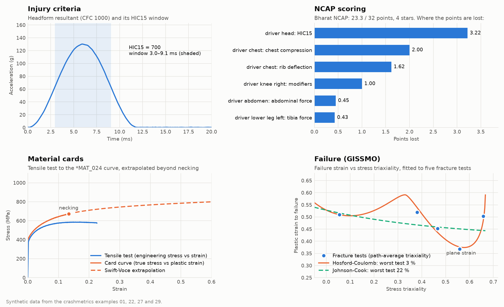

# crashmetrics

[](https://pypi.org/project/crashmetrics/)
[](https://pypi.org/project/crashmetrics/)
[](https://github.com/vsk1729/crashmetrics/actions/workflows/tests.yml)
[](https://vsk1729.github.io/crashmetrics/)
[](https://github.com/vsk1729/crashmetrics/blob/main/LICENSE)
[](https://doi.org/10.5281/zenodo.23806423)

**For crash CAE engineers: Euro NCAP and Bharat NCAP scores, dummy injury criteria and LS-DYNA material cards, in Python.**

[](https://vsk1729.github.io/crashmetrics/)

Open-source Python for automotive crash safety calculations: injury
criteria, Euro NCAP and Bharat NCAP scoring, pedestrian protection
(with bonnet clearance and bottoming out), homologation checks, test-versus-CAE correlation, LS-DYNA output readers,
energy and model quality checks, load path and spot weld analysis across runs.

**Documentation: <https://vsk1729.github.io/crashmetrics/>**, with
step-by-step guides, runnable examples, the full API reference and the
[protocol notes](https://vsk1729.github.io/crashmetrics/protocol-notes/)
(every interpretation the package makes).

**Development status:** alpha. Validate results against the official
protocol; the package does not certify regulatory compliance.

## Install

```bash
python -m pip install crashmetrics
```

Python 3.10 or later; the only dependency is NumPy 1.24 or later.

## What it covers

| Area | Highlights | Guide |
| --- | --- | --- |
| Signals | SAE J211 CFC filter, resultants, unit conversion, HIC (grid search or exact maximum, [verified](https://vsk1729.github.io/crashmetrics/guides/hic-accuracy/)), peak, 3 ms clip, exceedance curves | [Signals](https://vsk1729.github.io/crashmetrics/guides/signals/) |
| Pedestrian (Euro NCAP) | Headform grid with correction factor, blue / default-red / A-pillar points; aPLI, upper legform, total VRU score | [Headform](https://vsk1729.github.io/crashmetrics/guides/pedestrian-headform/), [Legforms](https://vsk1729.github.io/crashmetrics/guides/pedestrian-legforms/) |
| Bonnet clearance | Free space under every headform point to the hard parts, from the keyword mesh; space a HIC target needs; each impact's nodout: bottoming out, its time, hard part and residual energy, or a stiff bonnet; a map of why each point is red, points lost per cause, two design loops compared | [Bonnet clearance](https://vsk1729.github.io/crashmetrics/guides/bonnet-clearance/) |
| Pedestrian (India) | AIS-100 compliance: Flex-PLI and legacy legform, upper legform, HIC1000 / HIC1700 zones; Flex-PLI assessment interval and Euro NCAP Flex-PLI score | [Flex-PLI and AIS-100](https://vsk1729.github.io/crashmetrics/guides/flexpli-ais100/) |
| Frontal dummies | DAMAGE, BrIC, neck loads, Nij, R94 limits, chest deflection, VC, CTI, THOR Rmax and abdomen, acetabulum, iliac force drop, femur, Tibia Index, knee slider | [Frontal criteria](https://vsk1729.github.io/crashmetrics/guides/frontal-dummy-criteria/) |
| Euro NCAP 2026 | MPDB (20 points) and full width (10 points) with modifiers and the compatibility penalty; sled and virtual testing (VTC: model quality, ISO/TS 18571 validation, 10 points); side impact AE-MDB (15), pole (10) and far side (10) | [MPDB and full width](https://vsk1729.github.io/crashmetrics/guides/euroncap-frontal/), [Virtual testing](https://vsk1729.github.io/crashmetrics/guides/euroncap-virtual-testing/), [Side and far side](https://vsk1729.github.io/crashmetrics/guides/euroncap-side/) |
| Homologation | UN R94 / AIS-098, UN R95 / AIS-099 and UN R135 pass/fail per requirement with clause and utilisation; post-crash electrical safety (voltage, energy, IPXXB, isolation, electrolyte, REESS, fire) | [Homologation](https://vsk1729.github.io/crashmetrics/guides/homologation/) |
| Whiplash | BioRID NIC and Nkm; 2026 rear impact score (front seat geometry and medium/high sled pulses with capping, rear seats; 5 points) | [Rear impact](https://vsk1729.github.io/crashmetrics/guides/whiplash/) |
| Bharat NCAP | AIS-197 (2023 edition, ratings to September 2027) ODB frontal and MDB side scores, ES-2 criteria, pole test, star rating; scores straight from dummy channels or ISO-MME; named modifiers; scorecard with point losses and the next star; child occupant protection (Q1.5/Q3 dynamic, CRS installation, vehicle based); safety assist star qualifiers | [Bharat NCAP](https://vsk1729.github.io/crashmetrics/guides/bharat-ncap/), [Child occupant and rating](https://vsk1729.github.io/crashmetrics/guides/bharat-ncap-cop/) |
| Intrusion | Pedal, steering column, A-pillar, footwell intrusion relative to the vehicle (best-fit frame of reference nodes), one node or ground; dynamic and static; survival space between nodes | [Intrusion](https://vsk1729.github.io/crashmetrics/guides/intrusion/) |
| Vehicle | OLC, delta-V, rebound, crush, absorbed energy, CFE, SEA | [Pulse and energy](https://vsk1729.github.io/crashmetrics/guides/pulse-energy/) |
| Materials | Tensile tests from machine exports (CSV, text, xlsx): fracture cut, smoothing, toe correction; E, Rp0.2, Rm, Ag, A; Lüders plateau, machine compliance, mean curve and scatter of several specimens; true stress, necking, Swift / Voce / Hockett-Sherby / Swift-Voce extrapolation, n and K; Cowper-Symonds / Johnson-Cook rate fits and checked strain-rate `*DEFINE_TABLE`; the complete `*MAT_024` card in mm-ms-kg, mm-s-t, mm-s-kg or m-s-kg; GISSMO failure: failure strain against triaxiality from fracture tests and their paths (Hosford-Coulomb, Johnson-Cook, tabulated), instability from the FLC, element size regularisation, `*MAT_ADD_DAMAGE_GISSMO` written, read and checked; read, check, convert and compare existing cards, single-element verification, material library | [Material cards](https://vsk1729.github.io/crashmetrics/guides/material-cards/), [GISSMO](https://vsk1729.github.io/crashmetrics/guides/gissmo/) |
| Data formats | ISO-MME (ISO/TS 13499) read and write for test and simulation channels | [Virtual testing](https://vsk1729.github.io/crashmetrics/guides/euroncap-virtual-testing/), [Loading data](https://vsk1729.github.io/crashmetrics/getting-started/loading-data/) |
| LS-DYNA | ASCII output readers (nodout, rcforc, sleout, secforc, rwforc, sbtout, deforc, jntforc, abstat, rbdout, spcforc, swforc), `crashmetrics-ascii` to CSV; glstat / matsum energy checks, d3hsp run summary, `crashmetrics-energy` command | [ASCII output](https://vsk1729.github.io/crashmetrics/guides/lsdyna-ascii/), [LS-DYNA energy](https://vsk1729.github.io/crashmetrics/guides/lsdyna-energy/) |
| Load paths | Energy absorbed per part and group (matsum), section forces (secforc), load split between upper, middle and lower paths, crush sequence check, baseline against variant with the culprit parts, energy matrix of many runs; a synthetic frontal crash (matsum, secforc, swforc, glstat, sleout, d3hsp) to try it without a solver | [Load paths](https://vsk1729.github.io/crashmetrics/guides/load-paths/) |
| Spot welds | Failed and critical welds from swforc, utilisation against force limits, failure sequence and unzipping bursts, new and earlier failures against a baseline | [Spot weld failure](https://vsk1729.github.io/crashmetrics/guides/spot-welds/) |
| Model quality | One pass/fail sheet per run from d3hsp, glstat, matsum and sleout: termination, mass and centre of gravity against targets, added mass, time step and smallest elements, energy balance, negative contact energy; runs side by side | [Model quality](https://vsk1729.github.io/crashmetrics/guides/model-quality/) |
| Test vs CAE | ISO/TS 18571 rating (corridor, phase, magnitude, slope) and grade, corridor and cross-correlation (CC) rating, peak / timing / RMSE / Sprague & Geers / Russell errors | [Test-versus-CAE correlation](https://vsk1729.github.io/crashmetrics/guides/test-cae-correlation/) |
| Analytics and ML | Batch runs into tables; signal shape features, criteria and design parameters per run as a training set; DOE sampling (Latin hypercube, Halton, Morris) with LS-DYNA parameters; margins to limits as targets; sensitivity ranking (PRCC, Morris); probabilistic star ratings (Monte Carlo) | [Batch and analytics](https://vsk1729.github.io/crashmetrics/guides/batch-analytics/), [ML features](https://vsk1729.github.io/crashmetrics/guides/ml-features/), [DOE and sensitivity](https://vsk1729.github.io/crashmetrics/guides/doe-sensitivity/) |

## Quick examples

```python
from crashmetrics.lsdyna import read_nodout
from crashmetrics.pedestrian import calculate_hic, check_flexpli, hic_colour
from crashmetrics.signals import cfc_filter, resample_uniform, resultant, to_g, to_seconds

# HIC15 from an LS-DYNA nodout (mm-ms-kg): resample, filter each axis, then the resultant
nodout = read_nodout("run01/nodout", ids=[1001])            # headform CG node
t_s = to_seconds(nodout.time, "ms")
axes = []
for c in "xyz":
    t, a = resample_uniform(t_s, to_g(nodout.channel(f"{c}_acceleration"), "mm/ms^2"),
                            sample_rate=10_000.0)
    axes.append(cfc_filter(t, a, cfc=1000))
hic = calculate_hic(t, resultant(*axes), window_ms=15.0)
print(hic.value, hic_colour(hic.value))          # Euro NCAP headform colour

# AIS-100 Rev.1 Flex-PLI check (peaks in N m and mm)
check = check_flexpli(tibia_moment=300, mcl=20, acl=6, pcl=5)
print(check.passed, check.worst, check.utilisation)
```

Bharat NCAP star rating, Euro NCAP MPDB score, legform grids and more
are in the [guides](https://vsk1729.github.io/crashmetrics/guides/).

## Runnable examples

The [`examples/`](https://github.com/vsk1729/crashmetrics/tree/main/examples)
folder has thirty-four scripts, one per topic, from `01_signals_hic.py` to
`34_bonnet_clearance.py`, with synthetic data except the two LS-DYNA
examples, which read real output files. The test suite checks that
each one still prints exactly its documented output.

```bash
python examples/07_bharat_ncap.py
```

## Where the numbers come from

Formulas and limits come from publicly available protocols and
standards: Euro NCAP (assessment protocols, CP 005, CP 007), Bharat NCAP
(AIS-197), AIS-100, UN R94 and R127, UN GTR 9, FMVSS 208, SAE J211 and
published research. The tests reproduce the protocols' own worked
examples where they give one, and check other formulas against hand
calculations and closed-form solutions.

## Citing

If you use crashmetrics in your work, please cite it (Zenodo,
[doi:10.5281/zenodo.23806423](https://doi.org/10.5281/zenodo.23806423);
the "Cite this repository" button on GitHub gives the reference from
`CITATION.cff`).

## Contributing

Issues and pull requests are welcome, from code and test data to
protocol corrections. Start with
[CONTRIBUTING.md](https://github.com/vsk1729/crashmetrics/blob/main/CONTRIBUTING.md)
(setup, coding standards, how to add a criterion, an LS-DYNA reader or
an example, and the pull request checklist); see
[Development and releases](https://vsk1729.github.io/crashmetrics/about/development/)
for the checks CI runs, and the
[changelog](https://github.com/vsk1729/crashmetrics/blob/main/CHANGELOG.md)
for what changed.

## Disclaimer and trademarks

crashmetrics is an engineering calculation aid and an independent
open-source project. It is not affiliated with, endorsed by or sponsored
by Ansys, Euro NCAP, Bharat NCAP, ARAI, UNECE, ISO, PDB or any other organisation
whose software, file formats, protocols or regulations it refers to.
LS-DYNA, Ansys and Euro NCAP are trademarks or registered trademarks of
their respective owners, used here only to describe compatibility. The
LS-DYNA readers were written from the text layout of output files; no
LS-DYNA code or documentation is included.

## License

MIT. See the [LICENSE](https://github.com/vsk1729/crashmetrics/blob/main/LICENSE) file.

The real LS-DYNA and ISO-MME files in `tests/data/` come from other
MIT-licensed projects and keep their own copyright notices: each folder
has its licence file and a README naming the source and commit.
