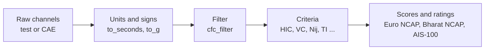

# Guides

One page per task. Each guide explains the steps, shows the code, and
ends with a complete runnable example from the `examples/` folder with
its real output (the test suite checks that output on every change).

| Guide | You will learn to | Example |
| --- | --- | --- |
| [Signals, HIC and the 3 ms clip](signals.md) | Filter channels, form resultants, compute HIC, peaks, 3 ms clips and exceedance curves | `01_signals_hic.py` |
| [Pedestrian headform](pedestrian-headform.md) | Score a Euro NCAP headform grid from CAE predictions and verification tests | `02_headform_grid.py` |
| [Pedestrian legforms and VRU score](pedestrian-legforms.md) | Score aPLI and upper legform grids and combine the total VRU score | `03_legform_vru.py` |
| [Flex-PLI and AIS-100](flexpli-ais100.md) | Process Flex-PLI signals and check AIS-100 compliance | `04_flexpli_ais100.py` |
| [Frontal dummy criteria](frontal-dummy-criteria.md) | Calculate head, neck, chest, abdomen, pelvis and leg criteria for the Hybrid III and THOR | `05_frontal_dummy_criteria.py` |
| [Euro NCAP MPDB and full width](euroncap-frontal.md) | Score the 2026 frontal tests with modifiers and compatibility | `06_euroncap_mpdb_fwdb.py` |
| [Bharat NCAP star rating](bharat-ncap.md) | Score the ODB frontal and MDB side tests and get the star rating | `07_bharat_ncap.py` |
| [Vehicle pulse and crush energy](pulse-energy.md) | Compute OLC, delta-V, crush, absorbed energy, CFE and SEA | `08_pulse_olc_crush.py` |
| [LS-DYNA energy checks](lsdyna-energy.md) | Check energy balance and read d3hsp run information | `09_lsdyna_energy_check.py` |
| [Batch runs, analytics and ML](batch-analytics.md) | Process many runs into a table for dashboards, DOE and ML | `10_batch_analytics.py` |
| [Features for machine learning](ml-features.md) | Turn runs into a feature table of criteria, signal shape and design parameters for ML models | `11_ml_features.py` |
| [Test-versus-CAE correlation](test-cae-correlation.md) | Rate CAE against test signals with ISO/TS 18571, the CC rating and error measures | `12_test_cae_correlation.py` |
| [Intrusion measurement](intrusion.md) | Measure pedal, steering column, A-pillar and footwell intrusion relative to the vehicle, from CAE or before/after test measurements | `13_intrusion.py` |

## The general workflow

Almost every calculation follows the same four steps:

1. **Load** the time base and channels as arrays.
2. **Convert** to the units and signs crashmetrics expects
   ([conventions](../getting-started/conventions.md)).
3. **Filter** each channel with its CFC.
4. **Calculate** the criteria, then **score** them for the protocol you
   need.

You can also start at step 4 or 5: if you already have peak values (from
a test report or a post-processor), the scoring functions take numbers
directly.
